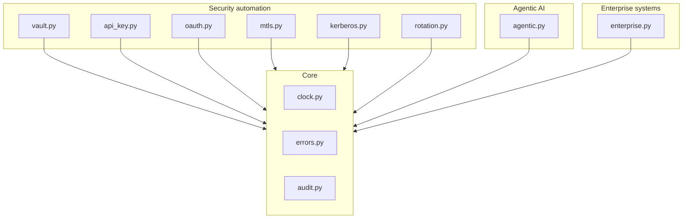

# Enterprise Authentication Patterns for Automation

**Recruiter summary.** Automation platforms authenticate to dozens of target
systems -- SAP, Oracle, Salesforce, ServiceNow, file shares, REST APIs -- and
each system has its own auth idiom. This repo is a working patterns library
implementing 7 auth patterns across 3 domains (security automation, agentic
AI, traditional enterprise software), with a decision guide for which pattern
fits which target. Proof: **89 tests, all green**, every failure mode tested
including the negative paths, stdlib only, fully deterministic.

## Purpose and who it is for

For engineers who integrate automation with enterprise systems and need to
answer "how should this job authenticate to that system?" with something
better than a hardcoded password. Also for AI-engineer interviews: each
pattern has a two-minute explanation in `docs/interview-points.md`.

## Architecture



Full diagrams: [`knowledge/04-architecture.md`](knowledge/04-architecture.md).
Study notes: [`knowledge/`](knowledge/) (linked per document).

## How it works, step by step

1. **Pick the pattern** from the [decision guide](knowledge/07-decision-guide.md)
   ("if the target is X, use pattern Y because Z").
2. **Fetch the credential** from the vault at job start (`vault.retrieve`) --
   never from the job definition.
3. **Authenticate** with the target's idiom: SAP user+client, Oracle wallet,
   org-bound Salesforce token, instance-bound ServiceNow auth, Kerberos
   ticket + ACL for shares, OAuth/mTLS/API key for services.
4. **Agents** get short-lived identity tokens; tool calls pass a governed
   registry that checks token, scopes, and an explicit grant.
5. **On failure**, the error taxonomy decides: retry (vault unreachable),
   rotate (expired), escalate (revoked). Every event lands in the
   hash-chained audit log.

## Real code, real output

Vaulted credential with rotation (`demos/demo_vault.py`):

```
stored, retrieved: True
after rotation: rotated-secret-002
vault offline -> code=vault_unreachable retryable=True
audit chain valid: True
audit holds fingerprints only: True
```

Governed agent tool call (`demos/demo_agentic.py`):

```
agent token valid for: planner-1
delegation: operator-ana -> planner-1
tool call: {'id': 'T-4242', 'status': 'open'}
refund blocked: bad_signature - agent lacks scopes ['write:orders'] for tool 'refund_order'
```

Zero-downtime rotation (`demos/demo_rotation.py`):

```
v1 works: primary
during overlap, v1 works: primary
during overlap, v2 works: primary
after overlap, v1 rejected: revoked_credential
after overlap, v2 works: primary
```

## How to run

Prerequisites: Python 3.10+ only. No dependencies, no network, no setup.

```bash
python3 -m pytest tests/ -q        # 89 tests
python3 scripts/count_tests.py     # prints the real total
python3 demos/demo_vault.py        # each demo is one command
python3 demos/demo_agentic.py
python3 demos/demo_enterprise.py
```

## Guardrails and security controls

- **Fail-closed everywhere:** unreachable vault hands out nothing; expired
  tokens authenticate nobody. No "allow on error" path exists.
- **Secrets never hit the audit log:** only SHA-256 fingerprints; a test
  scans the log for plaintext and fails if found.
- **Constant-time comparisons** for secrets, tickets, and tokens.
- **Revocation is never retryable** -- enforced by the taxonomy, not by
  convention.
- **Delegation subset rule:** an agent can never exceed its delegator's
  scopes; violations are rejected, not clamped.
- **Brand check** (`scripts/check_brands.py`): blocklist stored as hashes.

## Limitations and known failures

- All cryptography is **simulated** (HMAC stand-ins) for deterministic
  offline tests. Nothing here protects real secrets; see
  [`docs/threat-model.md`](docs/threat-model.md) and ADR 001.
- No network, no real KDC/OAuth server/TLS -- adopters map each module to
  production infrastructure via the implementation guide.
- Clock-skew leeway tolerates small drift; NTP is the real control.
- Known miss kept visible: the fake token endpoint has no rate limiting
  (brute-force protection is a production concern, noted in the threat
  model).

## Built vs planned

| Status | Item |
|---|---|
| Built | 7 auth patterns (vault, API key, OAuth2, mTLS, Kerberos, rotation, error taxonomy) |
| Built | Agentic-AI auth: agent tokens, scoped delegation, governed tool registry |
| Built | Enterprise idioms: SAP, Oracle wallet, Salesforce, ServiceNow, file shares |
| Built | Hash-chained audit log with tamper detection |
| Built | 89 tests incl. all failure paths; demos; knowledge/ + docs/ |
| Written, not run | CI workflow (`.github/workflows/ci.yml` ships in repo; runs on push) |
| Planned | LDAP/AD bind pattern; SCIM provisioning sketch |

## Docs

- [`docs/implementation-guide.md`](docs/implementation-guide.md) -- adopting
  these patterns in a real estate
- [`docs/interview-points.md`](docs/interview-points.md) -- two-minute
  explanations per pattern
- [`docs/threat-model.md`](docs/threat-model.md) -- STRIDE analysis
- [`docs/adr/`](docs/adr/) -- architecture decisions
- [`knowledge/`](knowledge/) -- study notes + Mermaid diagrams

## Related repos

- `Jagadish-agentic-security-layer` -- governed tool bridge and blast-radius
  analysis; this repo's `GovernedToolRegistry` is the auth half of that story
- `Jagadish-machine-identity-security` -- non-human identity lifecycle that
  consumes credentials like the ones modeled here
- `Jagadish-agent-auth-security` -- JWT/OAuth/DPoP mechanisms; complementary
  depth on the token layer

## License

MIT -- see [LICENSE](LICENSE).
