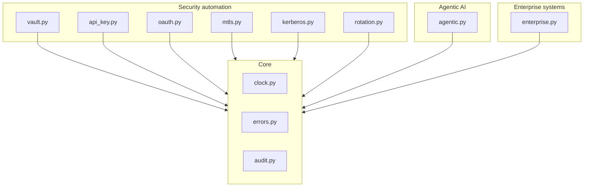

# Enterprise Authentication Patterns for Automation

**Recruiter summary.** Automation platforms authenticate to dozens of target
systems -- SAP, Oracle, Salesforce, ServiceNow, file shares, REST APIs -- and
each system has its own auth idiom. This repo is a working patterns library
implementing 7 auth patterns across 3 domains (security automation, agentic
AI, traditional enterprise software), with a decision guide for which pattern
fits which target. Proof: **111 offline tests** (count printed by
`scripts/count_tests.py` and re-checked in CI), including 19 regression tests
for nine auth bypasses found and fixed in review. Stdlib only, deterministic.

## Purpose and who it is for

For engineers who integrate automation with enterprise systems and need to
answer "how should this job authenticate to that system?" with something
better than a hardcoded password. Also for AI-engineer interviews: each
pattern has a two-minute explanation in `docs/interview-points.md`.

## Architecture



Full diagrams: [`knowledge/04-architecture.md`](knowledge/04-architecture.md).
Study notes: [`knowledge/`](knowledge/) (linked per document).

## How it works, step by step

1. **Pick the pattern** from the [decision guide](knowledge/07-decision-guide.md)
   ("if the target is X, use pattern Y because Z").
2. **Fetch the credential** from the vault at job start (`vault.retrieve`) --
   never from the job definition.
3. **Authenticate** with the target's idiom: SAP user+client, Oracle wallet,
   org-bound Salesforce token, instance-bound ServiceNow auth, Kerberos
   ticket + ACL for shares, OAuth/mTLS/API key for services.
4. **Agents** get short-lived identity tokens. A user delegates to an agent
   only by presenting a *signed* user token, and the delegation can never
   outlive it or exceed its scopes. Tool calls pass a governed registry that
   checks token, scopes, and an explicit grant approved by a named human
   other than the agent.
5. **On failure**, the error taxonomy decides: retry (vault unreachable),
   rotate (expired), escalate (revoked). Every event lands in the
   hash-chained audit log.

## Real code, real output

Delegation trusts only a verified user token (`authpatterns/agentic.py`):

```python
def delegate(self, user_token, agent_id, scopes):
    user_claims = self._validate_user(user_token)   # raises if forged/expired
    if user_claims.get("kind") in ("agent", "delegation") or "sub" not in user_claims:
        raise AuthError(AuthError.FORBIDDEN, "only a user token can delegate")
    ...
    if not wanted or not wanted <= user_scopes:
        raise AuthError(AuthError.SCOPE_EXCEEDED, ...)
    ...
    exp = min(exp, int(user_claims["exp"]))   # never outlive the user's token
```

The outputs below are real runs, regenerated by `scripts/render_docs.py` and
checked for drift in CI.

Each bypass found in review, now blocked (`demos/demo_bypasses_blocked.py`):

<!-- run: python demos/demo_bypasses_blocked.py -->
```text
client mints admin:all                       blocked: scope_exceeded
reports token replayed at billing API        blocked: wrong_service
cache asked for write, got scope:            write
delegation from forged {'sub': 'ceo'} dict   blocked: bad_signature
re-delegate a delegation to extend it        blocked: forbidden
agent approves its own grant                 blocked: forbidden
rotate a revoked API key                     blocked: revoked_credential
mTLS server without a pinned CN              blocked: TypeError
same-CA cert with another CN                 blocked: unknown_principal
```
<!-- /run -->

Governed agent tool call (`demos/demo_agentic.py`):

<!-- run: python demos/demo_agentic.py -->
```text
agent token valid for: planner-1
delegation: operator-ana -> planner-1
self-approved grant blocked: forbidden
tool call: {'id': 'T-4242', 'status': 'open'}
refund blocked: forbidden - agent lacks scopes ['write:orders'] for tool 'refund_order'
```
<!-- /run -->

Vaulted credential with rotation (`demos/demo_vault.py`):

<!-- run: python demos/demo_vault.py -->
```text
stored, retrieved: True
after rotation: rotated-secret-002
vault offline -> code=vault_unreachable retryable=True
audit chain valid: True
audit holds fingerprints only: True
```
<!-- /run -->

Zero-downtime rotation (`demos/demo_rotation.py`):

<!-- run: python demos/demo_rotation.py -->
```text
v1 works: primary
during overlap, v1 works: primary
during overlap, v2 works: primary
after overlap, v1 rejected: revoked_credential
after overlap, v2 works: primary
```
<!-- /run -->

Test count:

<!-- run: python scripts/count_tests.py -->
```text
111 tests collected
```
<!-- /run -->

## How to run

Prerequisites: Python 3.10+ and pytest (`pip install pytest`). No other
dependencies, no network, no cloud. There is no cloud mode.

```bash
python3 -m pytest -q               # full offline suite
python3 scripts/count_tests.py     # prints the real total
python3 scripts/render_docs.py --check   # documented output matches a fresh run
python3 scripts/check_brands.py    # hashed brand blocklist
python3 demos/demo_bypasses_blocked.py
python3 demos/demo_vault.py        # each demo is one command
python3 demos/demo_agentic.py
python3 demos/demo_enterprise.py
```

## Guardrails and security controls

Each line is enforced by tests in `tests/`.

- **Fail-closed everywhere:** an unreachable vault hands out nothing; expired
  tokens authenticate nobody. No "allow on error" path exists.
- **OAuth:** clients get only registered scopes; tokens carry `iss` and
  `aud`, and `validate()` checks both plus required scopes; TTL is bounded;
  the client cache is keyed by scope and audience.
- **Delegation:** only a signed user token can delegate (no claims dicts, no
  agent or delegation tokens, no self-delegation); scopes must be a subset
  (rejected, not clamped); the delegation expires no later than the user token.
- **No self-approval:** a tool grant needs a named approver who is not the
  agent; the approver is audited; tools cannot be re-registered under
  existing grants.
- **mTLS identity pinning:** the server must be told which client CN(s) to
  accept; a valid cert from the same CA with another CN is rejected.
- **No status oracle:** API keys and SAP logons check the secret before
  revealing revoked/locked/expired.
- **Secrets never hit the audit log:** only keyed HMAC-SHA256 fingerprints
  (key from `AUTHPATTERNS_FINGERPRINT_KEY`, random per process otherwise); a
  test scans the log for plaintext.
- **Constant-time comparisons** for secrets, tickets, and tokens.
- **Revocation is never retryable**, enforced by the taxonomy.
- **Brand check** (`scripts/check_brands.py`): blocklist stored as hashes.

## Limitations and known failures

- All cryptography is **simulated** (HMAC stand-ins) for deterministic
  offline tests. Nothing here protects real secrets; see
  [`docs/threat-model.md`](docs/threat-model.md) and ADR 001.
- No network, no real KDC/OAuth server/TLS. Adopters map each module to
  production infrastructure via the implementation guide.
- Known gaps, documented and not yet built:
  - agent and delegation tokens have a `jti` but no revocation list, so a
    leaked token stays valid until it expires (15 minutes by default);
  - Kerberos authenticators have no replay cache, and the fake KDC issues a
    ticket for any service name;
  - the vault has no per-caller authorization (anyone holding the object can
    read any secret);
  - the fake token endpoint and KDC have no rate limiting.
- Clock-skew leeway tolerates small drift; NTP is the real control.

## Built vs planned

| Status | Item |
|---|---|
| Built | 7 auth patterns (vault, API key, OAuth2 client credentials, mTLS, Kerberos, rotation, error taxonomy) |
| Built | Agentic-AI auth: agent tokens, verified-token delegation, governed tool registry with named approvers |
| Built | Enterprise idioms: SAP, Oracle wallet, Salesforce, ServiceNow, file shares |
| Built | Hash-chained audit log with keyed fingerprints and tamper detection |
| Built | 111 offline tests, demos, knowledge/ + docs/ |
| Built | CI (ruff, pytest, docs drift, brand check, gitleaks full history), CodeQL, Dependabot |
| Written, not run | Production mapping in the implementation guide (no real vault, KDC, IdP, or TLS was used) |
| Planned | Revocation list for agent/delegation tokens; Kerberos replay cache; vault caller authz |
| Planned | LDAP/AD bind pattern; SCIM provisioning sketch |

## Docs

- [`docs/implementation-guide.md`](docs/implementation-guide.md) -- adopting
  these patterns in a real estate
- [`docs/interview-points.md`](docs/interview-points.md) -- two-minute
  explanations per pattern
- [`docs/threat-model.md`](docs/threat-model.md) -- STRIDE analysis
- [`docs/adr/`](docs/adr/) -- architecture decisions
- [`knowledge/`](knowledge/) -- study notes + Mermaid diagrams

## Related repos

- `Jagadish-agent-auth-security` covers the token layer in depth (JWT, DPoP,
  OAuth, refresh-token reuse detection). Both repos have OAuth client
  credentials and delegation, so go there for depth on that layer. What is
  new here is the target-system idioms (SAP, Oracle wallet, Salesforce,
  ServiceNow, Kerberos file shares), dual-credential rotation, the
  fail-closed vault, and the retry/rotate/escalate error taxonomy.
- `Jagadish-agentic-security-layer`: governed tool bridge and blast-radius
  analysis. This repo's `GovernedToolRegistry` is the auth half of that story.
- `Jagadish-machine-identity-security`: non-human identity lifecycle that
  consumes credentials like the ones modeled here.

## Standardization review (2026-10-18)

Nine auth bypasses were reproduced on the original code and fixed, each with
regression tests in `tests/test_review_fixes.py`:

1. An OAuth client could mint any scope (for example `admin:all`).
2. Tokens had no issuer or audience, so a token for one API worked at any other.
3. The OAuth client cache returned a `read` token when `write` was requested.
4. Delegation accepted a plain claims dict (`{"sub": "ceo"}`), and a
   delegation could be re-delegated to outlive its 15-minute limit.
5. A revoked API key could be rotated into a working key.
6. File-share `operation="service"` matched the ACL's service field, so it
   granted access.
7. A wrong password revealed whether an SAP user or API key was locked,
   revoked, or expired.
8. The mTLS server accepted any CN signed by a trusted CA by default.
9. Tool grants needed no approver, so an agent could grant itself `delete_all`.

Also: audit fingerprints changed from an unkeyed SHA-256 prefix (which can
be brute-forced offline) to keyed HMAC-SHA256. Authorization denials now
report `forbidden` instead of `bad_signature`.

## License

MIT -- see [LICENSE](LICENSE).
