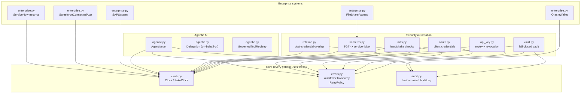
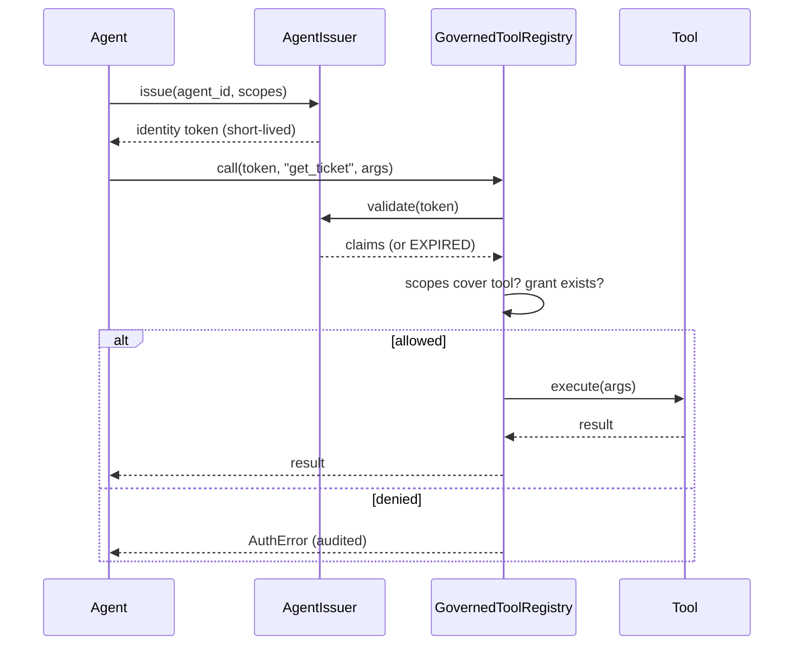
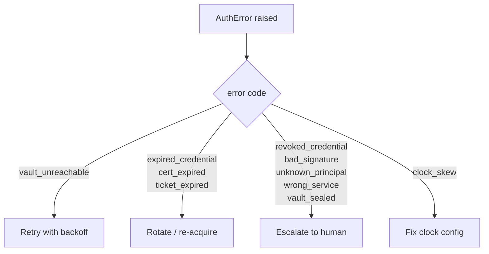

# Architecture

## Module map



## Request flow: governed tool call



## Rotation timeline

```mermaid
gantt
    title Zero-downtime rotation
    dateFormat HH:mm
    axisFormat %H:%M
    section Credentials
    old credential valid           :done, 00:00, 65m
    overlap (both valid)            :active, 60m, 5m
    new credential valid            :done, 60m, 120m
```

## Failure decision flow


